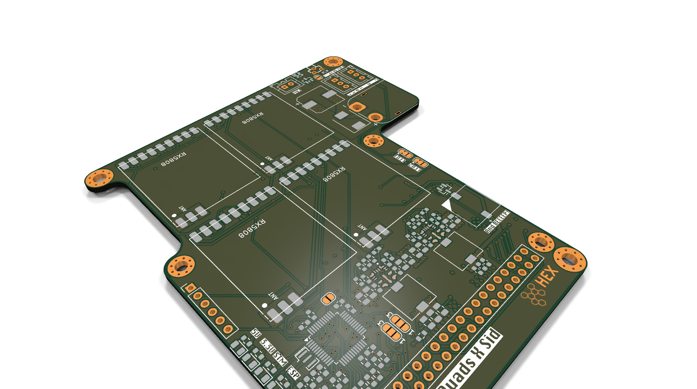
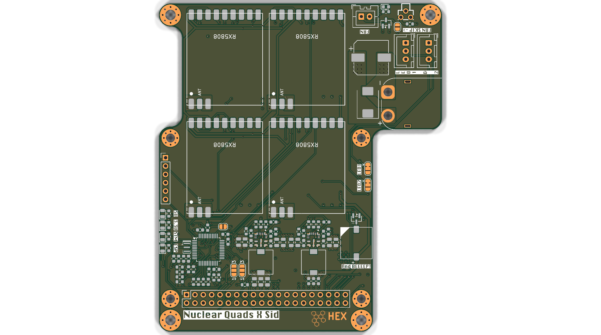
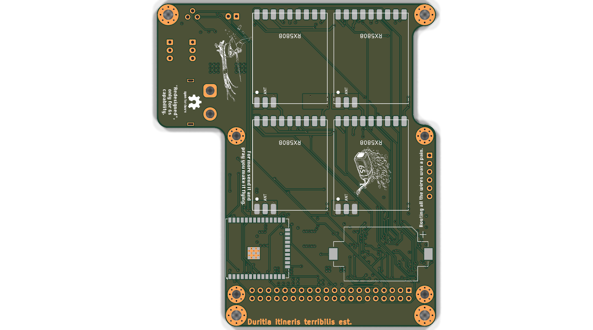
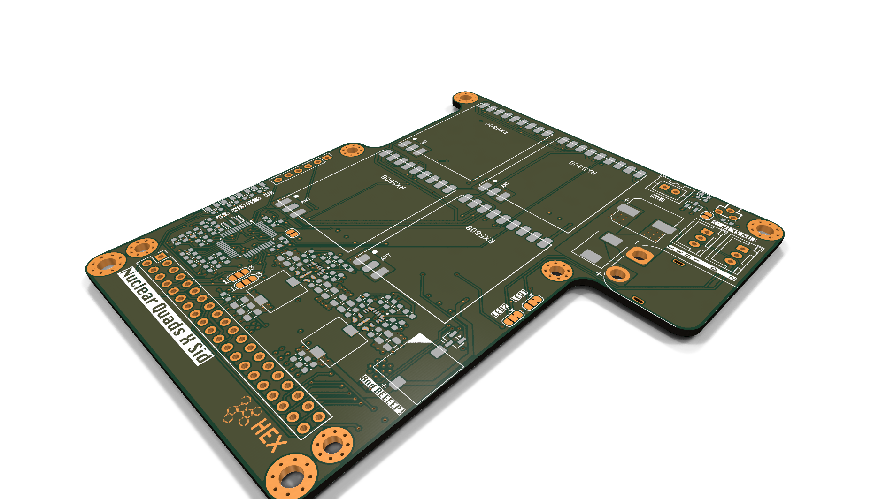

# Sid-FPV-timer

An integrated, multi-node FPV drone race timing and lap tracking system designed for competitive event management and RotorHazard compatibility.

<p align="center">
  
</p>

---

## Overview

**Sid-FPV-timer** is an all-in-one hardware timing platform engineered for competitive FPV drone racing. By integrating multi-channel RF receivers, dedicated timing control, robust power regulation, and host compute docking onto a single unified board, it simplifies trackside setup and eliminates complex external wiring harnesses.

Designed by **Siddesh Jain** at [Hex Aerospace](https://hexaerospace.in).

<p align="center">
  
  
</p>

---

## Highlights

- **Multi-Node RF Tracking:** Onboard receiver array designed for multi-pilot simultaneous race tracking and real-time signal analysis.
- **Host Compute Docking:** Direct interface for an onboard single-board computer running race timing management software.
- **Dedicated Timing Architecture:** Dedicated microcontrollers handling high-resolution lap detection, wireless connectivity, and telemetry.
- **Wide-Input Power Regulation:** High-efficiency power delivery and protection circuitry designed for field battery operation.
- **Peripherals & Thermal Management:** Headers and drivers for active cooling fans, audio/visual cues, and user inputs.

<p align="center">
  
</p>

---

## Inspiration & Acknowledgements

This project draws strong inspiration from the pioneering work of **[NuclearQuads](https://nuclearquads.com)** and their **NuclearHazard** timer series, which demonstrated the power of turnkey, manufacturer-assembled hardware for the open-source [RotorHazard](https://github.com/RotorHazard/RotorHazard) ecosystem.

---

## Project Structure

```text
Sid-FPV-timer/
├── PCB/                     # KiCad hardware design files
│   ├── production/          # Ready-to-order Gerber archives and SMT files
│   └── ...                  # Schematic sheets, board layout, and libraries
├── img/                     # 3D hardware renders & media assets
├── LICENSE                  # GNU AGPL-3.0
└── README.md
```

---

## Status

> [!NOTE]
> This project is currently in active hardware prototyping and validation. Detailed documentation, firmware setups, and assembly instructions will be expanded as revisions progress.

---

## Designer & Organization

- **Designer:** Siddesh Jain
- **Organization:** [Hex Aerospace](https://hexaerospace.in)

---

## License

This project is licensed under the **GNU Affero General Public License v3.0 (AGPL-3.0)**. See the [LICENSE](LICENSE) file for details.
